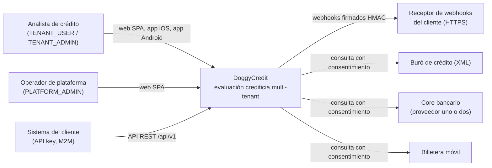
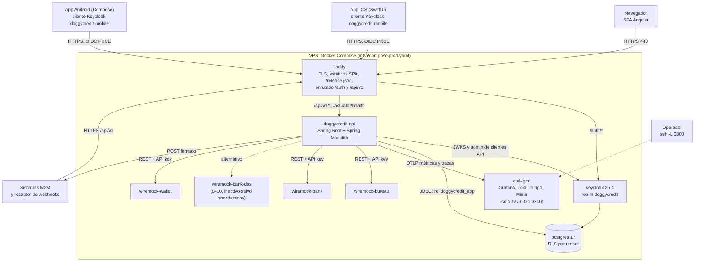

# Vistas C4: contexto y contenedores (estado construido)

Actualiza las vistas del informe de arquitectura v1 (§9.4–9.5) con lo que existe
en el repositorio al 2026-10-20. Los contenedores coinciden con los servicios de
`infra/compose.yaml` + `infra/compose.prod.yaml`; el dominio público es
`https://doggycredit.los5furiosos.cloud`.

## Nivel 1: contexto

Las tres fuentes externas están simuladas con WireMock en todos los entornos,
incluido el VPS (`contracts/connectors/README.md`); las respuestas se marcan
`simulado` y las apps muestran «Datos simulados».

## Nivel 2: contenedores

Notas verificables en los archivos:

- Solo `caddy` publica el puerto 443 (`infra/compose.yaml`); en producción los
  simuladores no se publican al host (`ports: !reset []`) y Grafana va solo a
  `127.0.0.1:3300`.
- Caddy nunca autoriza: borra `X-Tenant-*` entrante y el tenant sale del token
  (`infra/caddy/Caddyfile`). `/actuator/*` distinto de `health` responde 404.
- La API valida JWT con las claves de `keycloak:8080` por la red interna y el
  issuer público; entra a PostgreSQL con `doggycredit_app` (ADR-020), no con el
  administrador de Flyway.
- Postgres y Keycloak son servicios de `infra/compose.yaml` con
  `restart: unless-stopped` en producción.
- La imagen `caddy` lleva el build de la SPA (`web/Dockerfile`); en producción
  se usa `DC_WEB_IMAGE` de GHCR, y la API `DC_API_IMAGE`.
- Los diagramas de módulos internos de la API están en
  [modulith/](modulith/README.md).

## Módulos de la API (nivel 3, resumen)

Paquetes de `backend/src/main/java/com/doggycredit/`: `tenancy`, `consent`,
`customer`, `integration`, `scoring`, `assessment`, `recommendation`, `billing`,
`analytics`, `audit`, `webhooks` y `shared`. Cada uno expone su API en la raíz
del paquete y esconde su implementación en `internal/`; `ApplicationModulesTest`
rompe el build ante dependencias indebidas o ciclos.
